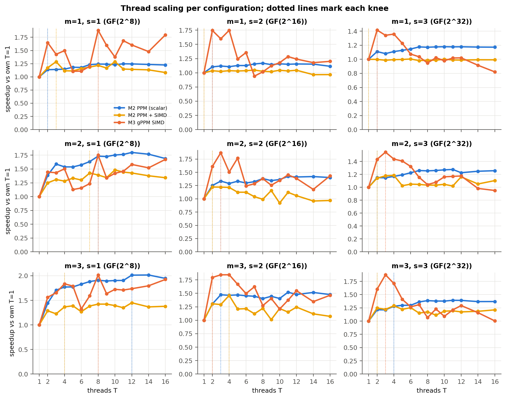
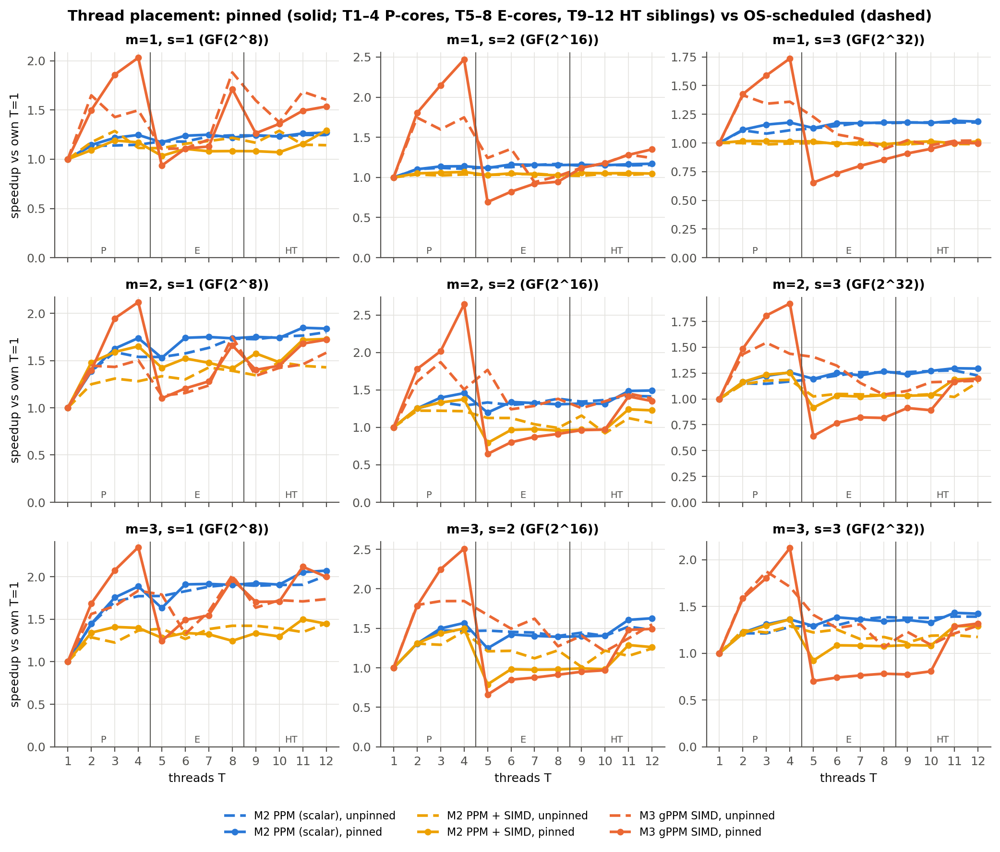
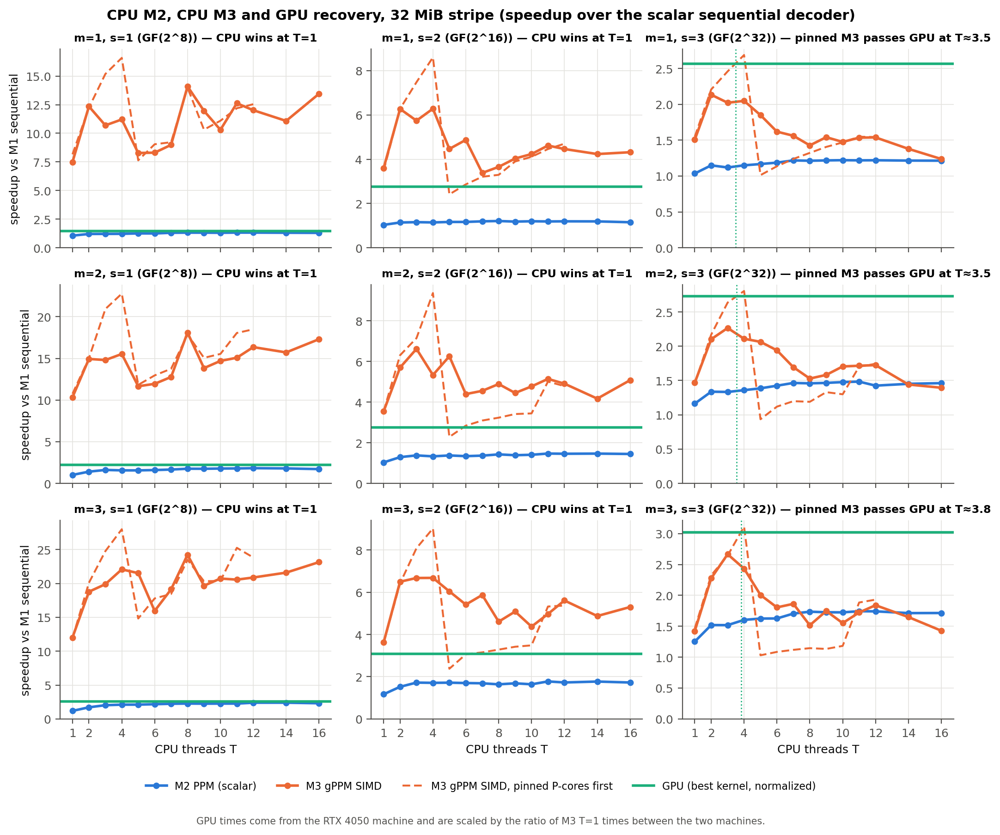
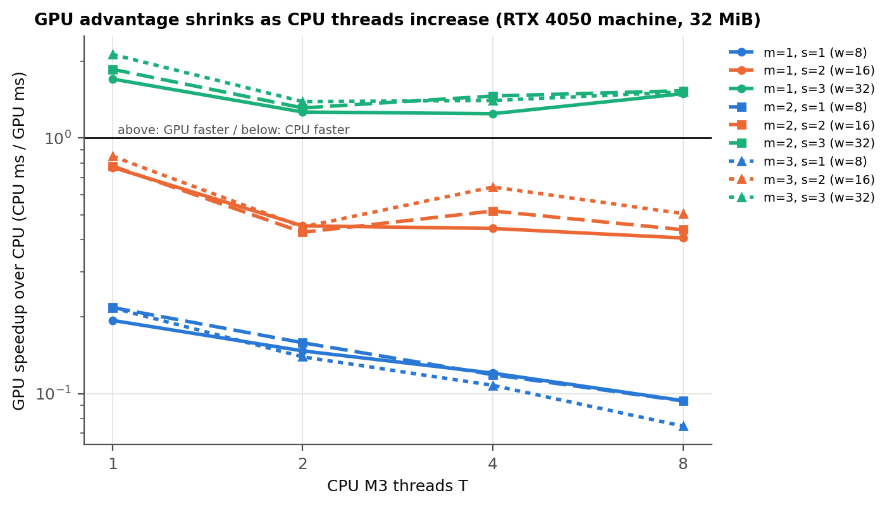
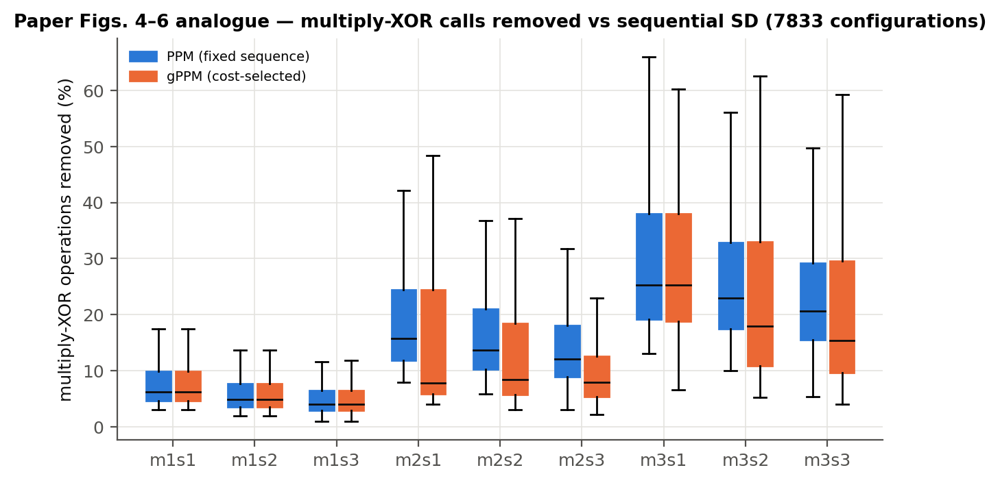
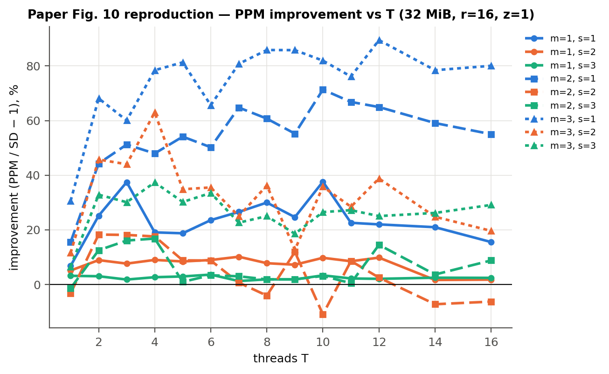
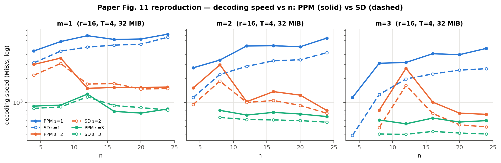
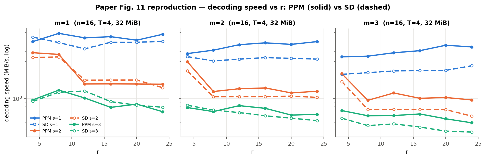
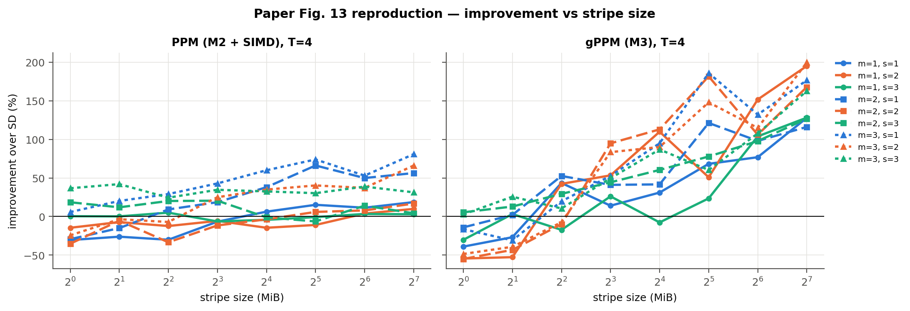
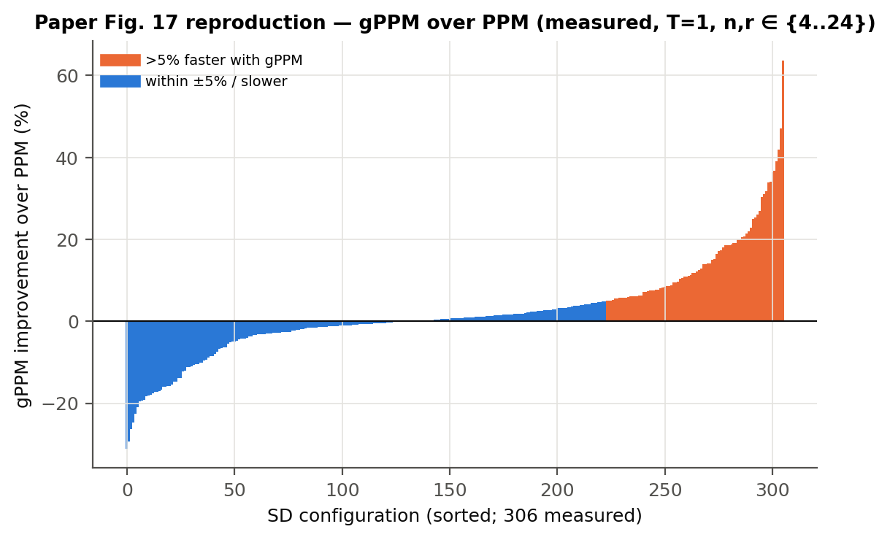

# gPPM evaluation: thread scaling, CPU vs GPU, ablation and paper reproductions

Measured 20 November 2026. Every number below comes from validated trials. Each trial checks the recovered bytes and the syndrome. All tables, including the full per-configuration ones, are in [`results/evaluation/tables.md`](../results/evaluation/tables.md). The raw trials are in [`results/evaluation/raw/`](../results/evaluation/raw/).

## Setup

| Item | Value |
|---|---|
| CPU (all new runs) | Intel Core i5-13420H. 4 P-cores with Hyper-Threading (CPUs 0–7) plus 4 E-cores (CPUs 8–11) = 12 logical CPUs. Power profile "balanced" |
| GPU data | Reused from Milestone 4, measured on a Core Ultra 9 185H with an RTX 4050 Laptop GPU. This machine has no NVIDIA GPU (see [GPU caveat](#gpu-caveat)) |
| Compiler | GCC, `-O2 -fopenmp`. `OMP_DYNAMIC=FALSE` |
| Workload | SD codes from the published FAST coefficients. Worst-case failure of m disks plus s sectors on z rows. Default n=r=16, z=1, 32 MiB stripe |
| Method | One warm-up, then 10 trials for scaling and 5–7 for the grids. Variants run in a seeded shuffled order within each round. Medians are reported |
| Reproduce | `make eval-build && make eval-benchmark && make eval-analyze` (about 30 min) |

The implementations compared all use one driver ([`src/evaluation/eval_bench.c`](../src/evaluation/eval_bench.c)), compiled against each milestone's decoder:

| Name | What it is |
|---|---|
| **M1** | Sequential baseline: scalar GF arithmetic, normal sequence, 1 thread |
| **SD (SIMD)** | Same sequential decoder with SIMD arithmetic. This is the paper's baseline, because the paper uses Intel SIMD |
| **M2** | PPM: fixed matrix-first sequence for the independent groups (OpenMP), serial normal-sequence remainder. Scalar |
| **M2 + SIMD** | M2's schedule linked against M3's SIMD arithmetic. This is the paper's PPM |
| **M3** | gPPM: cost-selected sequence, SIMD, and a parallel dependent remainder |
| **GPU** | Milestone 4 CUDA decoder. The best of the scalar and table kernels is used per configuration |

---

## 1. Where the parallel speedup tapers off

Separate plots: [M2](../results/evaluation/figures/scaling_m2_ppm_scalar.png) · [M2 + SIMD](../results/evaluation/figures/scaling_m2_ppm_plus_simd.png) · [M3](../results/evaluation/figures/scaling_m3_gppm_simd.png)

### The answer, in numbers

| Implementation | Peak speedup over its own T=1 | Peak at T | Speedup stops growing (last ≥5% gain) | Efficiency < 50% from | Fitted Amdahl serial fraction |
|---|---|---|---|---|---|
| **M2** (scalar) | 1.17–2.02× | 8–14 (flat plateau) | **T = 2–4**, but GF(2^8) with m ≥ 2 creeps up to T=8–12 | T = 3–4 | 0.44–0.85 |
| **M2 + SIMD** | 1.00–1.48× | 2–12 (flat plateau) | **T = 1–4** (m=2, s=1: T=7) | T = 2–3 | 0.67–1.00 |
| **M3**, OS-scheduled | 1.42–2.02× | GF(2^8): 8; GF(2^16): 3–4; GF(2^32): 2–3 | **T = 2–3**, or 8 for GF(2^8) | T = 3–4 | 0.49–0.83 |
| **M3**, pinned P-cores first | **1.74–2.64×** | **exactly T = 4 in all 9 configurations** | **T = 4** | T = 4–5 | n/a |

Per-configuration values are in the "Where parallel speedup tapers off" and "Taper with pinned placement" tables in `tables.md`.

What drives the taper:

1. **The serial remainder (Amdahl).** M2 recovers the dependent remainder serially. Fitting Amdahl's law gives a serial fraction of 0.44–0.85, so M2 can never exceed 1.2–2.3× however many threads it gets. Adding SIMD makes it worse: SIMD speeds up the parallel group work, so the serial part becomes a larger share. M2 + SIMD for m=1, s=3 does not speed up at all (1.00× at every T). This is why M3 parallelizes the remainder.
2. **Hybrid cores.** The pinned control places threads 1–4 on P-cores, 5–8 on E-cores and 9–12 on Hyper-Threading siblings. M3 rises steadily to T=4. Then at **T=5 it drops by 47–76%** relative to T=4 (to 0.64–1.24× its T=1 speed), because static OpenMP scheduling waits for the slowest thread, which is now on an E-core. Without pinning, the OS mixes P- and E-cores, which explains the jagged, lower curves.
3. **Oversubscription.** At T=16 (more threads than CPUs), M3 on GF(2^32) falls back to its T=1 speed or below (0.82–1.00×).

**Bottom line:** on this CPU, parallelization stops paying off **after T=4, the number of physical P-cores**, for every configuration. The paper reached the same conclusion on its 4-core E5-2603: "PPM achieves the maximum improvement when T = corenumbers".

---

## 2. M2 vs M3 vs GPU, and when the GPU overtakes the CPU

### 2a. Same machine (Core Ultra 9 185H + RTX 4050, Milestone 4 data, 32 MiB)

| Field | GPU vs CPU M3 at T = 1 / 2 / 4 / 8 | Verdict |
|---|---|---|
| GF(2^8) (s=1) | GPU 5–14× **slower** at every T | The CPU always wins, even single-threaded |
| GF(2^16) (s=2) | GPU 1.2–2.4× **slower** at every T | The CPU always wins, even single-threaded |
| GF(2^32) (s=3) | GPU **1.25–1.86× faster** at every T | The GPU always wins. The CPU's best is 25–40 ms against the GPU's 20–29 ms |

The GPU's advantage shrinks as the CPU adds threads. For GF(2^32) it falls from 1.7–2.1× at T=1 to 1.25–1.46× at T=2–4, but it never crosses 1 in the T=1–8 data.

**Stripe size also matters** (m=2, s=3; best CPU vs best GPU):

| Stripe | 8 MiB | 32 MiB | 128 MiB |
|---|---|---|---|
| GPU speedup | 2.58× | 1.31× | 0.71× |

**The GPU stops winning above about 66 MiB** (log-interpolated). For GF(2^8) and GF(2^16) the GPU loses at every size from 8 to 128 MiB.

### 2b. Projected onto this machine's T=1…16 sweep

To get finer thread resolution, each GPU time is multiplied by (M3 T=1 here) / (M3 T=1 on the GPU machine). That factor is 0.91–1.32 and cancels the difference in single-core speed between the two CPUs.

| | GF(2^8) | GF(2^16) | GF(2^32) |
|---|---|---|---|
| **GPU vs M2** | GPU faster at every T | GPU faster at every T | GPU faster at every T |
| **GPU vs M3, OS-scheduled** | M3 faster at T=1 | M3 faster at T=1 | GPU faster at every T |
| **GPU vs M3, pinned** | M3 faster at T=1 | M3 faster at T=1 | **M3 matches the GPU at T≈3.5–3.8 and passes it at T=4** |

Two limits on the GF(2^32) result:

- At T=4 the pinned M3 lead is only 3–5% (for example 22.4 ms vs 23.1 ms for m=2, s=3), which is within run-to-run variation and the projection's uncertainty.
- From T=5 onwards, pinned M3 falls back behind the GPU.

So the honest summary is **parity at exactly 4 P-cores**, not a clear win.

### GPU caveat

This laptop has no NVIDIA GPU or CUDA, so no new GPU measurements were possible. Section 2a compares hardware within a single machine and is the reliable result. Section 2b is a single-core-normalized projection across two machines. Re-running `make m4-benchmark` on the RTX 4050 laptop with more thread counts would confirm it.

---

## 3. Ablation

### A. Layers added one at a time (speedup over M1; 32 MiB, n=r=16)

| Layer added | geomean over the 9 (m,s) configurations | Range |
|---|---|---|
| M1 sequential scalar | 1.00× | |
| + PPM partitioning, fixed sequence (M2, T=1) | 1.10× | 1.01–1.25× |
| + SIMD region arithmetic | 3.63× | 1.38–12.2× (GF(2^8) gains most) |
| + gPPM cost-selected sequence | 3.75× | 1.45–13.3× |
| + 4 threads, independent groups only | 4.29× | 1.53–16.6× |
| + parallel dependent remainder (T=4) | **5.93×** | **2.05–22.1×** |
| + going to 8 threads | 4.92× (**worse**) | 1.43–24.2× |

### B. Leave one technique out (time relative to full M3 at T=8; above 1× means slower)

| Removed | geomean |
|---|---|
| SIMD | 1.77× slower. For GF(2^32) only, removing SIMD makes it 0.68–0.77×, i.e. *faster*: scalar GF(2^32) scales better across the E-cores |
| Partitioning entirely (sequential SD with SIMD) | 1.46× slower |
| Multithreading (T=1) | 1.32× slower |
| Parallel remainder | 1.21× slower |
| gPPM sequence selection | 1.18× slower |

### C. Full factorial

All combinations of arithmetic {scalar, SIMD} × sequence {fixed PPM, gPPM} × remainder {serial, parallel} × T {1, 2, 4, 8, 12} × the 9 (m,s) configurations are in `tables.md` (Ablation C) and `ablation_factorial.csv`. The best cell is SIMD + gPPM + parallel remainder at T=4 (5.93× geomean). With a serial remainder, threads beyond T=2 add almost nothing (4.21× → 4.31×).

### D/E. Parameters n, r, m, s and w (306 measured SD codes, n,r ∈ {4,8,…,24}, T=4)

Mean improvement of PPM over SD for each parameter value:

| n | 4 | 8 | 12 | 16 | 20 | 24 |
|---|---|---|---|---|---|---|
| | +77% | +43% | +29% | +27% | +25% | +23% |

| r | 4 | 8 | 12 | 16 | 20 | 24 |
|---|---|---|---|---|---|---|
| | +25% | +33% | +35% | +39% | +37% | +41% |

| m | 1 | 2 | 3 |
|---|---|---|---|
| | +10% | +36% | +63% |

| s | 1 | 2 | 3 |
|---|---|---|---|
| | +62% | +26% | +14% |

The improvement **shrinks as n or s grows and rises as m or r grows**. This is the same direction the paper reports in Section 5.2.

**Field width w** cannot be set independently. The FAST coefficients fix GF(2^w) for each (n,m,s,r), so the grid is grouped by w instead. The mean PPM improvement is:

| w | m=1 | m=2 | m=3 |
|---|---|---|---|
| 8 | +22% | +57% | +88% |
| 16 | 0% | +14% | +51% |
| 32 | −7% | +15% | +35% |

Narrower fields benefit most because their SIMD multiply is cheapest, so the structural savings dominate. The 6×6 n × r tables for each (m,s) are in `tables.md` (Ablation D).

### F. Stripe size (T=4)

At 1–4 MiB, PPM is slower than SD in 5 of the 9 configurations, because thread start-up dominates. From 64 MiB up it is ahead in all 9. This is the same trend as the paper's "steady improvement when the stripe size is larger than 8MB", but on this CPU the threshold is higher (16–64 MiB) because the per-sector work at small stripes is only microseconds.

### G. Failure rows z

Spreading the s sector failures over more rows (z=2,3) does not reduce M3's gain. At T=4 the improvement is +28% to +154% across all z. The paper saw "nearly the same performance improvement for different values of z".

---

## 4. Reproducing the original paper's results with our implementation

| Paper figure | Reproduction |
|---|---|
| Figs. 4–6: computational cost |  |
| Fig. 10: improvement vs T |  |
| Fig. 11: speed vs n and r |   |
| Fig. 13: improvement vs stripe size |  |
| Fig. 17: gPPM over PPM |  |

Figs. 12, 14, 15 and 16 are not reproduced:

- Fig. 12 compares three server CPUs, and we have only two laptops.
- Figs. 14–16 cover LRC, RS and GRS codes, which this project does not implement.

### Headline numbers

| Metric | Paper (E5-2603, T ≤ 4) | Ours (i5-13420H) |
|---|---|---|
| Maximum PPM improvement over SD | 210.81% | **+259.0%** (n×r grid, T=4) |
| Mean PPM improvement | 61.09% (8.22% to 210.81%) | **+35.1%** (−18.7% to +259.0%) |
| Mean improvement at T=2 | 46.29% (8.45% to 178.38%) | **+28.8%** (+3.0% to +68.1%) |
| Maximum gPPM improvement over PPM | 102.41% | **+63.7%** (T=1, isolating sequence choice) |
| Share of configurations where gPPM clearly beats PPM | ≈ 1/3 | **83 / 306 = 27%** (more than 5% faster) |

Why our numbers differ from the paper:

1. **Lower mean improvement.** Our grid includes small stripes per sector and wide GF(2^16)/GF(2^32) codes. On this CPU those make PPM slightly *slower* (minimum −18.7%). The paper reports only positive cases.
2. **Hybrid CPU.** The paper's 4 identical cores scale cleanly. On this CPU, unpinned threads land on E-cores (Section 1).
3. **Comparing gPPM against PPM.** gPPM is measured at T=1 to isolate the sequence choice. At T=4, M3 is also helped by its parallel remainder, which M2 lacks, so it shows +46% to +124% over M2. That gain is not attributable to gPPM itself.
4. **Weighted cost vs operation count.** gPPM minimizes the weighted cost C = u + c·v. Counted in raw multiply-XOR calls, it uses fewer than PPM in only 370 of 7,833 configurations (Figs. 4–6 analogue). Its measured gains come from choosing cheaper-per-call sequences, not fewer calls.

---

## Files

| Path | Contents |
|---|---|
| `src/evaluation/eval_bench.c` | Benchmark driver: any thread list, any (n,m,s,r,z), stripe size, serial or parallel remainder |
| `scripts/run_evaluation.py` | Experiments: `scaling`, `scaling_pinned`, `nr`, `stripe`, `z` |
| `scripts/analyze_evaluation.py` | Medians, taper and crossover metrics, all tables and figures |
| `results/evaluation/raw/*.csv` | 23,028 validated per-trial rows |
| `results/evaluation/tables.md` | Every table, including the per-configuration ones |
| `results/evaluation/*.csv` | Machine-readable summaries (taper, crossover, ablation, n×r) |
| `results/evaluation/figures/` | PNG and SVG for every plot |
| `results/evaluation/environment*.json` | Host, compiler, load average and git HEAD for each run |
