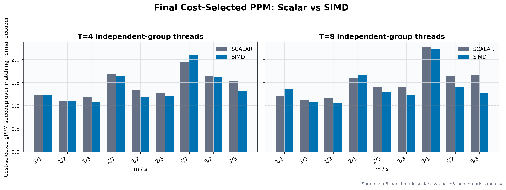
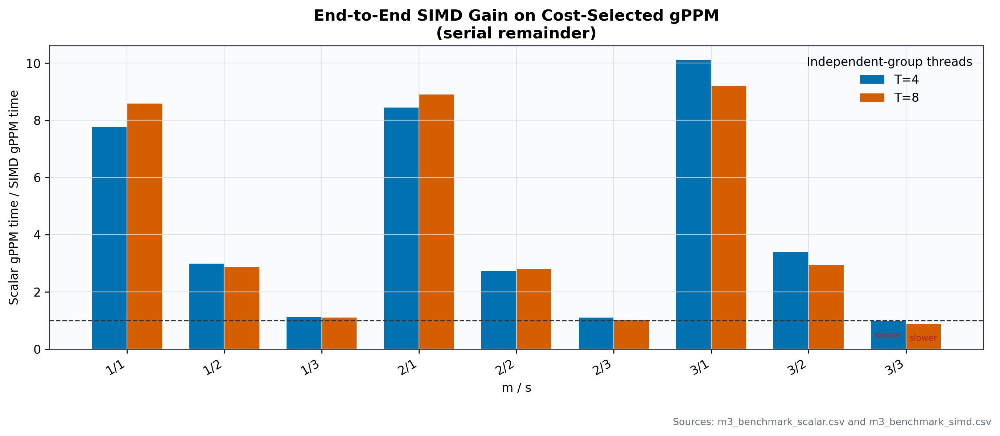
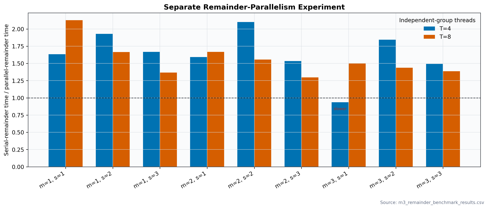

# Milestone 3: Final Cost-Selected PPM With and Without SIMD

This report compares the final M3 cost-selected PPM decoder with SIMD disabled
and enabled. **Both benchmark variants keep the dependent remainder serial.**
The separate byte-range-parallel remainder experiment is reported later and is
not included in this SIMD comparison.

The evaluation is organized as an optimization ladder:

| Layer | Implementation | What it adds |
|---|---|---|
| L0 | Scalar whole-matrix normal | Reference baseline |
| L1 | Scalar cost-selected gPPM, serial remainder | Cost selection and PPM independent-group parallelism |
| L2 | SIMD cost-selected gPPM, serial remainder | SIMD arithmetic on top of L1 |
| L3 | SIMD cost-selected gPPM, parallel remainder | Byte-range parallelism on top of L2 |

For each layer, **cumulative speedup** is `L0 time / layer time`; **incremental
gain** is `previous layer time / current layer time`. The comparison is reported
at T=4 and T=8.

## 1. Problem and comparison

M2 provided two relevant paths: the sequential whole-matrix normal decoder, and
fixed PPM, which matrix-first decodes independent groups in parallel and then
normal-decodes the remainder. M2 did not select between whole-matrix decoding
and PPM based on estimated cost. M2 region arithmetic was scalar.

M3 adds the gPPM cost selector and SIMD `mult_XORs()` kernels. To measure the
**final decoder-level SIMD gain**, the same M3 source and gPPM selection are
benchmarked twice:

- **Scalar M3:** compiled with `M3_DISABLE_SIMD`; all region operations use
  `mult_XORs_scalar()`.
- **SIMD M3:** normal M3 build; `mult_XORs()` dispatches to SSSE3/AVX2 when
  supported, otherwise falls back to scalar.

Both builds use the same workload, benchmark code, thread counts (T=4 and T=8
for independent groups), and **one thread for the dependent remainder**. Each
build measures its own whole-matrix normal baseline as well as its selected gPPM
path. This makes the reported PPM gain a comparison against the matching
normal decoder, and the scalar-vs-SIMD comparison a comparison of the final
gPPM decoder rather than an isolated arithmetic loop.

## 2. What M3 selects and where

The cost model compares three candidates for each recovery:

- Whole-matrix normal:
  `Cnormal = u(S) + u(F^-1) + c·(v(S) + v(F^-1))`
- Whole-matrix matrix-first:
  `Cmatrix = u(F^-1·S) + c·v(F^-1·S)`
- Partitioned PPM: for every independent group and the remainder, select its
  cheaper normal or matrix-first sequence, then sum those costs.

`u(M)` counts nonzero coefficients and `v(M)` counts coefficients greater than
one. Thus `u` models the region operations and `c·v` weights the additional
field-multiplication work. It estimates arithmetic work, not elapsed time or
thread overhead.

Implementation locations:

- `ec_choose_sequence()` in [`src/milestone3/codec.c`](../src/milestone3/codec.c)
  calculates the normal and matrix-first costs for one `(F^-1,S)` pair.
- `mat_nonzeros()`, `mat_non_ones()`, and `mat_mul()` in
  `src/milestone3/matrix.c` provide `u`, `v`, and the matrix-first product.
- `ppm_recover_sd_config()` in [`src/milestone3/ppm.c`](../src/milestone3/ppm.c)
  compares the whole-matrix cost with the sum of PPM component costs. It selects
  PPM only when that estimate is lower, then executes the selected sequence for
  each component.
- `gf_cost_c()` in [`src/milestone3/gf.c`](../src/milestone3/gf.c) times
  coefficient-one XOR versus coefficient-two multiply-XOR on 256 KiB regions
  for eight rounds. It calculates
  `c = multiply-XOR time / XOR time - 1` and caches one value per field width.

The benchmark calibrated these `c` values independently for each build:

| Field | Scalar build `c` | SIMD build `c` |
|---|---:|---:|
| GF(2^8) | 1.4010 | 0.8750 |
| GF(2^16) | 0.8223 | 6.6415 |
| GF(2^32) | 0.0000 | 7.5849 |

The values are specific to this CPU and arithmetic implementation. In
particular, scalar GF(2^32) measured coefficient-two multiply-XOR no slower than
coefficient-one XOR, so the formula clamps the estimated extra cost to zero;
this is a measured model input, not a claim that multiplication takes no
hardware work.

## 3. SIMD design and final-decoder results

**SSE3** is a 128-bit packed-integer SIMD extension. M3 uses **SSSE3**, an
extension to SSE3 that provides the byte-shuffle instruction `pshufb`.
**AVX2** provides 256-bit packed-integer operations and integer gathers. These
were chosen because region symbols are contiguous and each output symbol can be
computed independently. The SIMD paths keep the existing scalar path as a
runtime fallback.

The kernels in [`src/milestone3/gf.c`](../src/milestone3/gf.c) work as follows:

- **GF(2^8), SSSE3:** nibble contribution tables and `pshufb` handle 16 bytes
  per vector.
- **GF(2^16), AVX2:** low/high-byte contribution tables and gathers handle eight
  symbols per vector.
- **GF(2^32), AVX2:** four byte-contribution tables and gathers handle eight
  symbols per vector.

The build without `M3_DISABLE_SIMD` runtime-dispatches to these kernels when
supported. `make m3-benchmark` builds both M3 variants from the same source;
the scalar binary uses `-DM3_DISABLE_SIMD`. Each runs 10 trials per
configuration for a 32 MiB stripe at T=4 and T=8. Both use the cost selector and
keep the remainder serial.

Platform: Intel Core Ultra 9 185H, GCC 11.4.0, `-O2 -fopenmp`. The following
table reports median recovery times in milliseconds and PPM speedup over the
matching build's whole-matrix normal decoder. The final column is the scalar
gPPM time divided by the SIMD gPPM time at T=8.

| m | s | Field | Normal scalar | gPPM scalar T=8 | PPM gain scalar | Normal SIMD | gPPM SIMD T=8 | PPM gain SIMD | SIMD gain on gPPM |
|---:|---:|---|---:|---:|---:|---:|---:|---:|---:|
| 1 | 1 | GF(2^8) | 36.167 | 29.762 | 1.22× | 4.716 | 3.464 | 1.36× | 8.59× |
| 1 | 2 | GF(2^16) | 55.263 | 49.234 | 1.12× | 18.529 | 17.241 | 1.07× | 2.86× |
| 1 | 3 | GF(2^32) | 43.994 | 37.786 | 1.16× | 36.252 | 34.292 | 1.06× | 1.10× |
| 2 | 1 | GF(2^8) | 66.675 | 41.453 | 1.61× | 7.774 | 4.653 | 1.67× | 8.91× |
| 2 | 2 | GF(2^16) | 83.878 | 59.592 | 1.41× | 27.589 | 21.339 | 1.29× | 2.79× |
| 2 | 3 | GF(2^32) | 57.644 | 41.276 | 1.40× | 50.156 | 40.818 | 1.23× | 1.01× |
| 3 | 1 | GF(2^8) | 104.658 | 46.142 | 2.27× | 11.103 | 5.013 | 2.21× | 9.20× |
| 3 | 2 | GF(2^16) | 125.408 | 76.377 | 1.64× | 36.446 | 26.013 | 1.40× | 2.94× |
| 3 | 3 | GF(2^32) | 76.143 | 45.720 | 1.67× | 66.410 | 52.010 | 1.28× | 0.88× |

The SIMD-backed final gPPM path is much faster for the GF(2^8) cases and faster
for most GF(2^16) cases. For GF(2^32) at `(m,s)=(3,3)`, the T=8 SIMD gPPM time is
about 14% slower than the scalar gPPM time; `(m,s)=(2,3)` is approximately even.
The PPM gain over normal also differs by backend because SIMD changes the
measured `c` and therefore can change which candidate the selector chooses.
At T=8, cost-selected PPM gains over its matching normal decoder range from
**1.12× to 2.27× without SIMD** and **1.06× to 2.21× with SIMD**. The complete
SIMD gPPM decoder is 0.88×–9.20× the scalar gPPM time across the tested fields
and configurations.

Raw per-trial results are in [`m3_benchmark_scalar.csv`](m3_benchmark_scalar.csv)
and [`m3_benchmark_simd.csv`](m3_benchmark_simd.csv). Both builds passed all
**270/270** trials with byte equality, checksum, and syndrome validation.

## 4. Separate remainder-parallelism experiment

This experiment is **not part of the scalar-vs-SIMD comparison above**. It
measures the additional byte-range parallel remainder change while the
independent-group phase uses the same thread count. `ec_decode_normal_parallel()`
in `src/milestone3/codec.c` assigns symbol-aligned byte ranges to OpenMP workers.
Each worker computes its own range of `T = S·BS` and then its range of
`BF = F^-1·T`, writing disjoint bytes in the shared `T` buffer and stripe. The
logical operation counter still counts one full-region operation, not one per
chunk.

In the separate 32 MiB, 10-trial experiment, T=4 improved eight of nine
configurations; `(m,s)=(3,1)` was about 6% slower. At T=8, all nine improved.
The detailed serial-versus-parallel remainder table and methods are in
[`m3_remainder_benchmark_results.csv`](m3_remainder_benchmark_results.csv),
with summary plots below.

## 5. Correctness, plots, and remaining work

- `make test`: M1, M2, and M3 tests pass, including SIMD-versus-scalar output
  equality for all supported fields.
- `make m3-sweep`: **7,833/7,833** feasible published SD points pass; 105 points
  are infeasible. See [`m3_sweep_results.csv`](m3_sweep_results.csv).
- `make m3-benchmark`: scalar and SIMD builds each pass **270/270** trials.
- `make m3-plots`: generates the PNG and SVG plots in
  [`milestone3/`](milestone3/).

No CUDA backend has been implemented. The M2 report's OpenMP/GPU rationale,
thread-count discussion, plateau analysis, and M1 memory estimates should be
carried into the final paper; related work still needs to be synthesized there.

