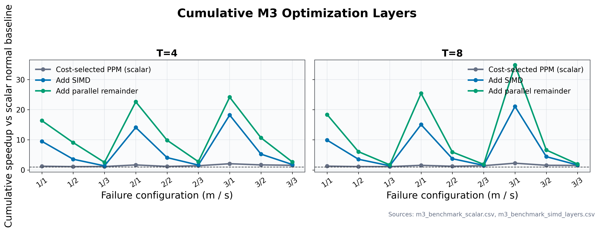
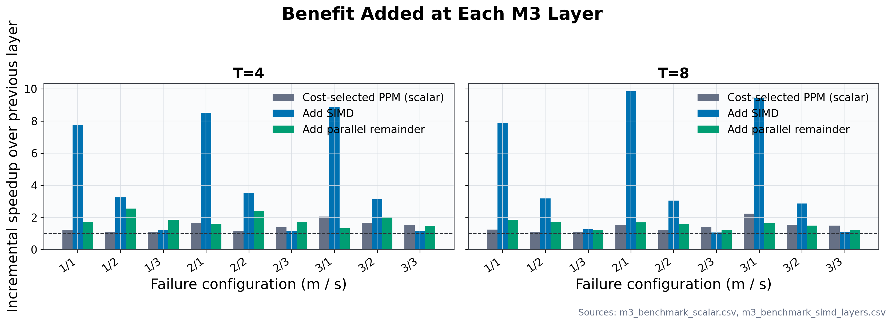

# Milestone 3: Final Cost-Selected PPM With and Without SIMD

This report measures three successive M3 changes on top of the scalar normal
baseline: cost-selected PPM, SIMD, then parallel remainder. The scalar PPM layer
and the first SIMD PPM layer both keep the remainder serial; the final layer
enables remainder parallelism.

The evaluation is organized as an optimization ladder:

| Layer | Implementation | What it adds |
|---|---|---|
| L0 | Scalar whole-matrix normal | Reference baseline |
| L1 | Scalar cost-selected gPPM, serial remainder | Cost selection and PPM independent-group parallelism |
| L2 | SIMD cost-selected gPPM, serial remainder | SIMD arithmetic on top of L1 |
| L3 | SIMD cost-selected gPPM, parallel remainder | Byte-range parallelism on top of L2 |

For each layer, **cumulative speedup** is `L0 time / layer time`; **incremental
gain** is `previous layer time / current layer time`. The comparison is reported
at T=4 and T=8.

## 1. Problem and comparison

M2 provided two relevant paths: the sequential whole-matrix normal decoder, and
fixed PPM, which matrix-first decodes independent groups in parallel and then
normal-decodes the remainder. M2 did not select between whole-matrix decoding
and PPM based on estimated cost. M2 region arithmetic was scalar.

M3 adds the gPPM cost selector and SIMD `mult_XORs()` kernels. To measure the
**final decoder-level SIMD gain**, the same M3 source and gPPM selection are
benchmarked twice:

- **Scalar M3:** compiled with `M3_DISABLE_SIMD`; all region operations use
  `mult_XORs_scalar()`.
- **SIMD M3:** normal M3 build; `mult_XORs()` dispatches to SSSE3/AVX2 when
  supported, otherwise falls back to scalar.

The scalar run uses T=4/8 independent groups and a serial remainder. The SIMD run
measures both serial and parallel remainder variants at T=4/8 in the same
process, so L2 and L3 share the same SIMD cost calibration. Both CSVs record a
whole-matrix normal time; the layer table and plots use the scalar normal time
as the common L0 baseline. The scalar-vs-SIMD comparison is therefore an
end-to-end decoder comparison, not an isolated arithmetic-loop comparison.

## 2. What M3 selects and where

The cost model compares three candidates for each recovery:

- Whole-matrix normal:
  `Cnormal = u(S) + u(F^-1) + c·(v(S) + v(F^-1))`
- Whole-matrix matrix-first:
  `Cmatrix = u(F^-1·S) + c·v(F^-1·S)`
- Partitioned PPM: for every independent group and the remainder, select its
  cheaper normal or matrix-first sequence, then sum those costs.

`u(M)` counts nonzero coefficients and `v(M)` counts coefficients greater than
one. Thus `u` models the region operations and `c·v` weights the additional
field-multiplication work. It estimates arithmetic work, not elapsed time or
thread overhead.

Implementation locations:

- `ec_choose_sequence()` in [`src/milestone3/codec.c`](../src/milestone3/codec.c)
  calculates the normal and matrix-first costs for one `(F^-1,S)` pair.
- `mat_nonzeros()`, `mat_non_ones()`, and `mat_mul()` in
  `src/milestone3/matrix.c` provide `u`, `v`, and the matrix-first product.
- `ppm_recover_sd_config()` in [`src/milestone3/ppm.c`](../src/milestone3/ppm.c)
  compares the whole-matrix cost with the sum of PPM component costs. It selects
  PPM only when that estimate is lower, then executes the selected sequence for
  each component.
- `gf_cost_c()` in [`src/milestone3/gf.c`](../src/milestone3/gf.c) times
  coefficient-one XOR versus coefficient-two multiply-XOR on 256 KiB regions
  for eight rounds. It calculates
  `c = multiply-XOR time / XOR time - 1` and caches one value per field width.

The benchmark calibrated these `c` values independently for each build:

| Field | Scalar build `c` | SIMD build `c` |
|---|---:|---:|
| GF(2^8) | 1.3264 | 0.1625 |
| GF(2^16) | 1.1222 | 6.2941 |
| GF(2^32) | 0.0000 | 7.0000 |

The values are specific to this CPU and arithmetic implementation. In
particular, scalar GF(2^32) measured coefficient-two multiply-XOR no slower than
coefficient-one XOR, so the formula clamps the estimated extra cost to zero;
this is a measured model input, not a claim that multiplication takes no
hardware work.

## 3. SIMD design and final-decoder results

**SSE3** is a 128-bit packed-integer SIMD extension. M3 uses **SSSE3**, an
extension to SSE3 that provides the byte-shuffle instruction `pshufb`.
**AVX2** provides 256-bit packed-integer operations and integer gathers. These
were chosen because region symbols are contiguous and each output symbol can be
computed independently. The SIMD paths keep the existing scalar path as a
runtime fallback.

The kernels in [`src/milestone3/gf.c`](../src/milestone3/gf.c) work as follows:

- **GF(2^8), SSSE3:** nibble contribution tables and `pshufb` handle 16 bytes
  per vector.
- **GF(2^16), AVX2:** low/high-byte contribution tables and gathers handle eight
  symbols per vector.
- **GF(2^32), AVX2:** four byte-contribution tables and gathers handle eight
  symbols per vector.

The build without `M3_DISABLE_SIMD` runtime-dispatches to these kernels when
supported. `make m3-benchmark` builds both M3 variants from the same source;
the scalar binary uses `-DM3_DISABLE_SIMD`. The scalar run has a serial
remainder; the SIMD run measures both serial and parallel remainder. All runs use
10 trials per configuration, a 32 MiB stripe, and T=4/8 independent groups.

Platform: Intel Core Ultra 9 185H, GCC 11.4.0, `-O2 -fopenmp`. The table reports
median recovery times in milliseconds at T=8. All cumulative speedups use the
same L0 scalar-normal baseline.

| m | s | Field | L0 baseline ms | L1 scalar gPPM ms | L1/L0 | L2 SIMD gPPM ms | L2/L0 | L2/L1 | L3 SIMD+parallel remainder ms | L3/L0 | L3/L2 |
|---:|---:|---|---:|---:|---:|---:|---:|---:|---:|---:|---:|
| 1 | 1 | GF(2^8) | 37.117 | 30.355 | 1.22× | 3.620 | 10.25× | 8.39× | 1.824 | 20.35× | 1.98× |
| 1 | 2 | GF(2^16) | 58.476 | 53.766 | 1.09× | 16.490 | 3.55× | 3.26× | 9.074 | 6.44× | 1.82× |
| 1 | 3 | GF(2^32) | 49.676 | 40.971 | 1.21× | 32.778 | 1.52× | 1.25× | 28.298 | 1.76× | 1.16× |
| 2 | 1 | GF(2^8) | 80.202 | 42.704 | 1.88× | 4.432 | 18.10× | 9.63× | 2.247 | 35.70× | 1.97× |
| 2 | 2 | GF(2^16) | 108.199 | 64.262 | 1.68× | 21.281 | 5.08× | 3.02× | 13.155 | 8.23× | 1.62× |
| 2 | 3 | GF(2^32) | 65.577 | 46.875 | 1.40× | 40.838 | 1.61× | 1.15× | 33.214 | 1.97× | 1.23× |
| 3 | 1 | GF(2^8) | 109.453 | 48.962 | 2.24× | 4.571 | 23.94× | 10.71× | 2.493 | 43.91× | 1.83× |
| 3 | 2 | GF(2^16) | 134.078 | 75.863 | 1.77× | 26.667 | 5.03× | 2.84× | 17.240 | 7.78× | 1.55× |
| 3 | 3 | GF(2^32) | 82.796 | 49.135 | 1.69× | 45.670 | 1.81× | 1.08× | 40.898 | 2.02× | 1.12× |

At T=8, L1 adds **1.09×–2.24×** cumulative speedup over L0. Adding SIMD raises
cumulative speedup to **1.52×–23.94×**; its incremental gain over L1 is
**1.08×–10.71×**. Adding the parallel remainder raises cumulative speedup to
**1.76×–43.91×**, an incremental **1.12×–1.98×** over L2. SIMD contributes most
in GF(2^8); GF(2^32) gains are smaller. SIMD changes `c`, so the selector can
choose a different strategy in L2 than in L1.

Raw per-trial results are in [`m3_benchmark_scalar.csv`](m3_benchmark_scalar.csv)
and [`m3_benchmark_simd_layers.csv`](m3_benchmark_simd_layers.csv). All **270**
scalar-build trials and **450** SIMD-build trials passed byte equality,
checksum, and syndrome validation.

## 4. Layer L3: parallel remainder

This is the additional optimization after L2. It measures byte-range
parallelism in the dependent remainder while the independent-group phase uses
the same thread count. `ec_decode_normal_parallel()`
in `src/milestone3/codec.c` assigns symbol-aligned byte ranges to OpenMP workers.
Each worker computes its own range of `T = S·BS` and then its range of
`BF = F^-1·T`, writing disjoint bytes in the shared `T` buffer and stripe. The
logical operation counter still counts one full-region operation, not one per
chunk.

In the 32 MiB, 10-trial experiment, T=4 improved eight of nine configurations;
`(m,s)=(3,1)` was about 6% slower. At T=8, all nine improved. The serial and
parallel remainder variants are both in
[`m3_benchmark_simd_layers.csv`](m3_benchmark_simd_layers.csv).

## 5. Correctness, plots, and remaining work

- `make test`: M1, M2, and M3 tests pass, including SIMD-versus-scalar output
  equality for all supported fields.
- `make m3-sweep`: **7,833/7,833** feasible published SD points pass; 105 points
  are infeasible. See [`m3_sweep_results.csv`](m3_sweep_results.csv).
- `make m3-benchmark`: scalar build passes **270/270** trials; SIMD build passes
  **450/450** trials across serial/parallel remainder variants.
- `make m3-plots`: generates the PNG and SVG plots in
  [`milestone3/`](milestone3/).

The CUDA backend is implemented and measured as a separate source checkpoint;
see [`milestone_gpu/GPU_Results.md`](milestone_gpu/GPU_Results.md) and
[`docs/Milestone_GPU_Plan.md`](../docs/Milestone_GPU_Plan.md). The M2
report's OpenMP/GPU rationale, thread-count discussion, plateau analysis, and M1
memory estimates should be carried into the final paper; related work still needs
to be synthesized there.

