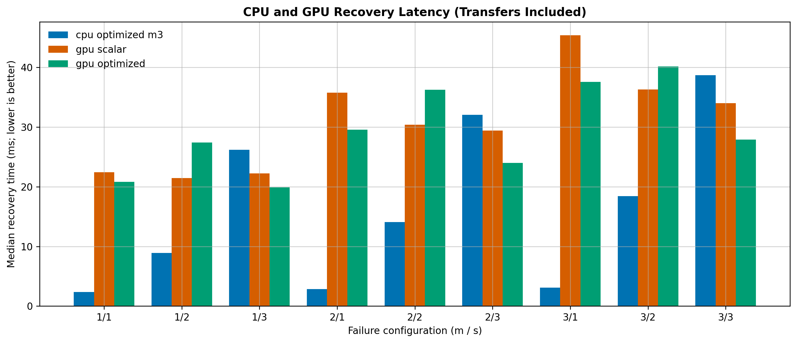
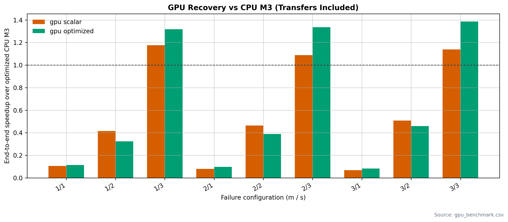

# GPU checkpoint: verified implementation and results

Evaluated 1 November 2026. This is a separate checkpoint from CPU Milestones
1–3. The implementation builds and runs; the table-based GPU decoder wins over
optimized CPU M3 in the three tested GF(2^32) configurations, but not in the
six smaller-field configurations.

## Implementations

| Variant | Execution |
|---|---|
| CPU optimized M3 | M3 cost selection, SSSE3/AVX2 arithmetic, eight OpenMP workers requested for independent groups and the normal remainder |
| GPU scalar | One CUDA thread per output field symbol; shift/reduce multiplication using the same field polynomials as the CPU |
| GPU optimized | Same CUDA schedule, with log/antilog multiplication for GF(2^8/16) and split-byte tables for GF(2^32) |

“GPU scalar” is a reference arithmetic implementation within CUDA SIMT
execution, not a single GPU thread. “Optimized” identifies the table variant;
it does not imply that it is faster on every field.

The host prepares and inverts coefficient matrices and selects normal,
matrix-first, or partitioned recovery using `C = u + c*v`. Normal recovery uses
two matrix-vector kernels; matrix-first uses one. Each kernel accumulates a
complete output symbol in a register, fusing region multiply-XOR work rather
than launching a kernel per coefficient. Adjacent threads access adjacent
symbols. Independent groups use separate nonblocking streams and separate
scratch storage. All groups finish before the dependent remainder starts.
The stripe is copied to the device once per recovery and copied back once.
Coefficient matrices and source/destination mappings are copied for each
matrix-vector product. Tables, allocations, streams, and events are created
and released per recovery, rather than cached across measured recoveries.

## Environment and methodology

- Ubuntu 22.04.5 LTS; Intel Core Ultra 9 185H.
- NVIDIA GeForce RTX 4050 Laptop GPU, 6,141 MiB reported memory;
  driver 580.178.04; CUDA compiler 13.0.88.
- GCC/G++ 11.4.0; C `-O2 -fopenmp`; CUDA `-O2 -std=c++14`.
- `n=r=16`, `z=1`, all nine `(m,s)` pairs in `{1,2,3}^2`.
- Exactly 32 MiB per stripe: 256 sectors of 128 KiB.
- Deterministic synthetic data and the same published coefficients and fault
  layout across variants. `s=1,2,3` selects fields of width 8,16,32 respectively.
- One warm-up per variant/configuration, then ten measured trials. Variants run
  sequentially in CPU, GPU-scalar, GPU-table order. Results are ratios of median
  recovery times, not averages of per-trial speedups.
- Host wall-clock timing surrounds the complete recovery call, including
  matrix preparation/selection, allocation, transfers in both directions,
  launches, synchronization, and destruction. Initial field construction,
  calibration in the warm-up, fault injection, validation and CSV I/O are outside
  measured trials. These are warmed-runtime measurements, not cold CUDA startup.
- CUDA-event durations are summed separately over all recovery kernels.
  Concurrent streams can make this sum **larger than end-to-end wall time**.
  It is neither GPU elapsed wall time nor a transfer/setup-time decomposition.

## End-to-end performance

All times below are medians in milliseconds. CPU/table speedup greater than one
means the table GPU implementation is faster than CPU M3. Scalar/table gain
greater than one means tables improve on GPU scalar.

| m | s | Field | CPU M3 ms | GPU scalar ms | GPU table ms | CPU / table | Scalar / table |
|---:|---:|---|---:|---:|---:|---:|---:|
| 1 | 1 | GF(2^8) | 2.359 | 22.451 | 20.813 | 0.113× | 1.079× |
| 1 | 2 | GF(2^16) | 8.887 | 21.428 | 27.386 | 0.325× | 0.782× |
| 1 | 3 | GF(2^32) | 26.170 | 22.253 | 19.870 | 1.317× | 1.120× |
| 2 | 1 | GF(2^8) | 2.866 | 35.754 | 29.543 | 0.097× | 1.210× |
| 2 | 2 | GF(2^16) | 14.086 | 30.371 | 36.268 | 0.388× | 0.837× |
| 2 | 3 | GF(2^32) | 32.032 | 29.426 | 23.980 | 1.336× | 1.227× |
| 3 | 1 | GF(2^8) | 3.107 | 45.353 | 37.567 | 0.083× | 1.207× |
| 3 | 2 | GF(2^16) | 18.416 | 36.269 | 40.136 | 0.459× | 0.904× |
| 3 | 3 | GF(2^32) | 38.682 | 33.979 | 27.915 | 1.386× | 1.217× |

The table GPU variant improves GF(2^8) and GF(2^32) relative to GPU scalar,
but regresses GF(2^16). Table accesses, per-call table transfer, and the selected
arithmetic schedule all affect these full-decoder comparisons. The results do
not isolate the cost of each component, so they do not prove a particular
bottleneck. GPU overhead is not amortized sufficiently to beat the fast CPU
GF(2^8/16) paths in these workloads. The GF(2^32) CPU path is slower, leaving
enough work for GPU execution to yield a measured end-to-end benefit.

## Aggregate kernel-event durations

These are medians of the per-trial kernel-duration **sums**, in milliseconds.
They must not be subtracted from end-to-end time to infer transfer time.

| m | s | GPU scalar sum ms | GPU table sum ms |
|---:|---:|---:|---:|
| 1 | 1 | 50.116 | 47.721 |
| 1 | 2 | 30.201 | 35.321 |
| 1 | 3 | 21.369 | 17.810 |
| 2 | 1 | 141.549 | 98.119 |
| 2 | 2 | 86.261 | 90.619 |
| 2 | 3 | 59.978 | 35.989 |
| 3 | 1 | 181.958 | 144.424 |
| 3 | 2 | 115.368 | 106.632 |
| 3 | 3 | 83.212 | 53.776 |

## GPU-specific cost calibration

Calibration uses 32,768 symbols, four warm-up pairs and sixteen interleaved
coefficient-one/coefficient-two pairs. Each probe is a separate kernel launch;
the ratio of median event times minus one, clamped at zero, estimates `c`.
Separate launches avoid identical XORs cancelling inside a probe loop.
Values are cached per field and variant; CPU calibration is independent.
Short memory-bound probes and event resolution limit the model's precision;
it estimates arithmetic work, not optimal elapsed time or stream overhead.

| Field | GPU scalar c | GPU table c |
|---|---:|---:|
| GF(2^8) | 0.428571 | 0.142857 |
| GF(2^16) | 1.000000 | 1.571429 |
| GF(2^32) | 1.714286 | 0.285714 |

All recorded CPU and GPU trials selected partitioned recovery. The selector
still compares whole-matrix candidates; no claim is made that this nine-case
benchmark exercises every possible strategy choice.

## Correctness and checks

- `make gpu-test`: **12/12** forced direct/two-stage matrix-vector checks,
  **64/64** small-stripe SD recoveries, and **27/27** 32 MiB smoke trials pass.
- Matrix-vector tests cover all three fields and both GPU arithmetic variants,
  zero/one/nontrivial coefficients, and 1,031-symbol regions to exercise partial
  CUDA blocks. Outputs are compared with scalar CPU arithmetic.
- Small-stripe recovery tests use published `n=r=4` and `n=r=24` coefficients,
  all `m,s=1..3`, and all geometrically feasible `z=1..s` values, with both
  variants. They check exact original bytes and zero syndrome.
- `compute-sanitizer --tool memcheck --error-exitcode 1 ./build/test_gpu`:
  **zero errors** with CUDA 13.0 Compute Sanitizer.
- `make gpu-benchmark`: **270/270** timed trials pass byte equality, checksum,
  and zero syndrome. Logical operation counts are recorded and must stay equal
  to each variant's warm-up count. These GPU counts are host matrix-derived,
  not a counter of physical GPU instructions or launches.
- `make test`: all existing CPU GF, SD, coefficients, PPM, and M3 tests pass.

Coverage is not exhaustive over every SD configuration or fault placement.
This GPU validation must not be confused with the CPU M3 7,833-point sweep.

## Reproduction and artifacts

```sh
make gpu-test
/usr/local/cuda-13.0/bin/compute-sanitizer --tool memcheck --error-exitcode 1 ./build/test_gpu
make gpu-benchmark
make gpu-plots
```

Make discovers CUDA in PATH or `/usr/local/cuda*/bin/`; override with
`NVCC=/path/to/nvcc` as needed. The backend uses stream-ordered allocation,
requiring a CUDA runtime/device supporting `cudaMallocAsync` (CUDA 11.2+).

- [Raw timed trials](gpu_benchmark.csv) — all 270 rows, including checksums,
  cost weights, selection, logical operation counts and kernel-duration sums.
- [Smoke trials](gpu_smoke.csv).
- Plots are provided in PNG and editable SVG form:
  [latency](gpu_recovery_latency.png),
  [GPU versus CPU speedup](gpu_vs_cpu_speedup.png), and
  [table-variant gain](gpu_kernel_optimization_gain.png).





Further optimization could reuse device buffers/tables across requests, compress
sparse coefficient matrices, and specialize field kernels. Any such change
requires a new benchmark rather than reinterpreting these measurements.
